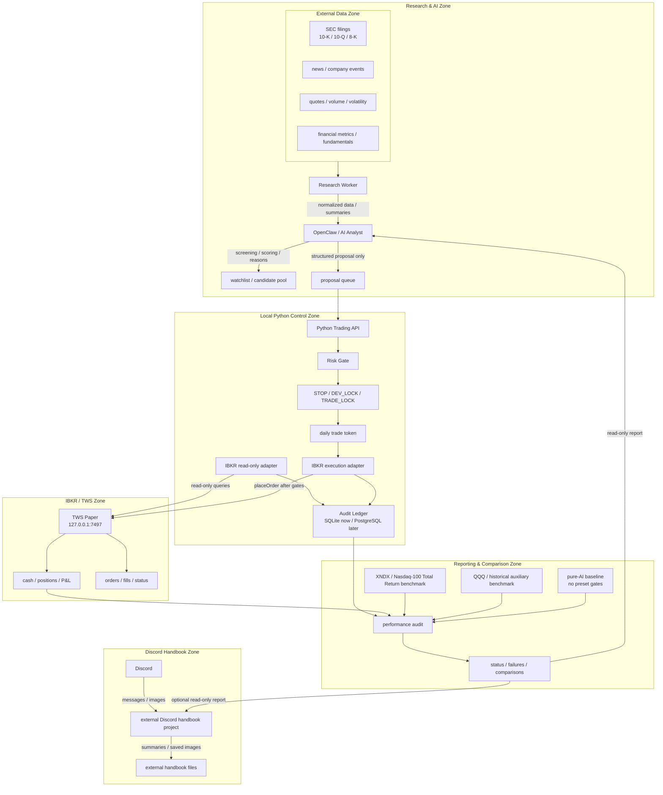
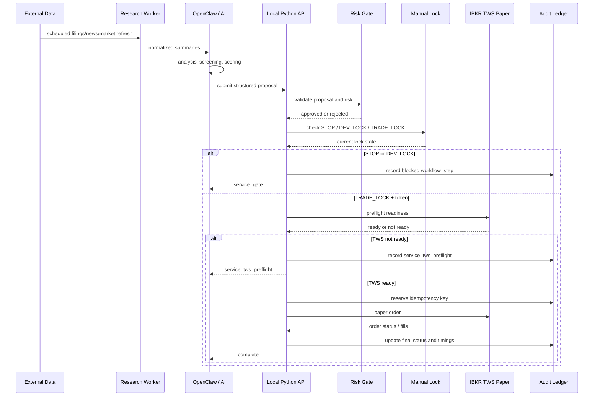
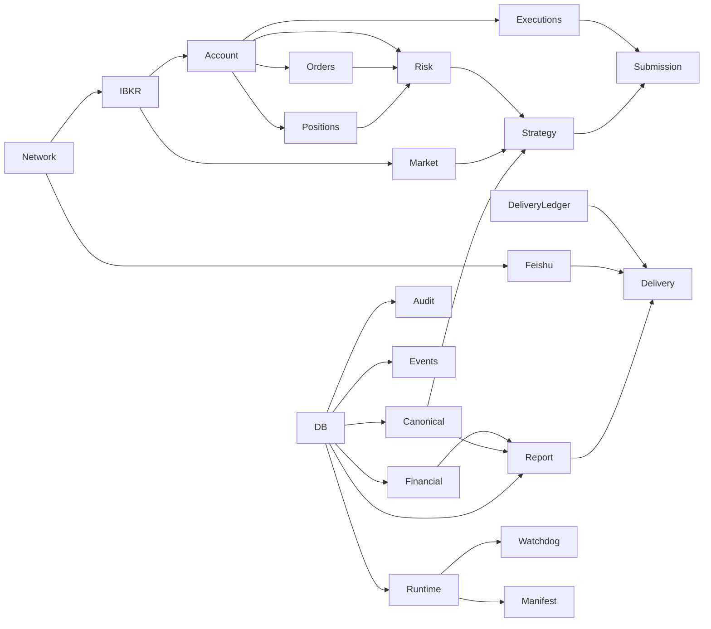

# Architecture

This project is organized around five layers: data, research, decision, risk,
and execution/audit. The core boundary is that Discord and OpenClaw do not touch
IBKR directly. All broker actions go through the local Python gateway.

## Layer Map



## Trigger And Confirmation Flow



## Tool Responsibilities

Discord handbook project:

- Moved out of this trading gateway to
  `/Users/nbhsbgnb/Documents/discord_handbook_project`.
- No trading permissions.

`openclaw/`:

- OpenClaw client and future AI analyst integration.
- May call the Python API.
- Must not connect directly to the IBKR/TWS port.

`api_service.py` and `trading/`:

- The controlled execution gateway.
- Owns parsing, risk checks, lock checks, TWS preflight, audit writes, and paper
  order submission.

`trading/tws_paper.py`:

- IBKR paper execution adapter.
- Long term, read-only IBKR functions should live beside but separate from this
  execution path.

`trading/audit.py`:

- SQLite execution audit for idempotency and order history.
- Future performance and research audit can move to PostgreSQL when multiple
  workers or larger datasets require it.

## Timing Optimization Path

The critical latency path is:

```text
data signal -> research summary -> OpenClaw decision -> proposal submit
-> Python parse -> risk -> lock/token -> TWS preflight -> audit reserve
-> placeOrder -> TWS acknowledgement -> audit update
```

Existing measured fields already cover the Python and broker portion:

- `openclaw_command_total_ms`
- `openclaw_http_round_trip_ms`
- `service_parse_ms`
- `service_risk_ms`
- `service_gate_ms`
- `service_tws_preflight_ms`
- `service_audit_reserve_ms`
- `service_broker_submit_ms`
- `broker_connect_handshake_ms`
- `broker_place_orders_ms`
- `broker_wait_ack_ms`
- `broker_total_ms`
- `service_audit_update_ms`
- `service_total_ms`

Future fields should cover the earlier decision path:

- `data_signal_received_at`
- `research_started_at`
- `research_finished_at`
- `openclaw_decision_started_at`
- `openclaw_decision_finished_at`
- `proposal_submitted_at`
- `order_acknowledged_at`

Optimization should start with measurement, then reduce repeated TWS handshakes,
avoid unnecessary full-context AI calls, cache normalized filings, and keep the
execution request payload small and structured.

## Fast Trade Check Mode

Research mode and fast trade check mode are intentionally different.

Research mode may spend time on:

- filings, news, and market context
- account, order, position, and P&L reads
- multiple AI reasoning passes
- report generation
- Discord or handbook summaries

Fast trade check mode starts only after the trading window, symbol, side, size,
and limit price are already selected. Its path is:

```text
prepared proposal -> OpenClaw paper-limit --fast -> Python API
-> parse -> risk -> lock/token -> TWS preflight -> audit reserve
-> placeOrder -> acknowledgement -> audit update
```

Fast mode must not perform these steps before submission:

- account order history query
- positions query
- market snapshot query
- report file generation
- attachment sending
- long narrative response

The OpenClaw `--fast` flag skips the OpenClaw-side health preflight to avoid a
duplicate TWS readiness check. It does not bypass the Python gateway. The Python
gateway still performs final risk, lock, daily token, TWS preflight,
idempotency, and audit checks.

The expected operator behavior is:

1. Use research mode before the window.
2. Keep read-only IBKR data warm in a cache.
3. Enter `TRADE_LOCK` locally when ready.
4. Use fast mode for the actual proposal submission.
5. Generate reports and attachments after the order response is recorded.

## Extension Space

The architecture reserves room for:

- factor models
- momentum and trend models
- mean reversion models
- volatility and risk parity models
- event-driven earnings models
- valuation models
- portfolio optimization
- benchmark comparison against XNDX first, with QQQ retained as a historical
  auxiliary benchmark
- pure-AI baseline comparison without preset strategy rules

These models should produce structured scores or proposals. They should not gain
direct execution rights.

## Modular Learning Path

Each new finance concept should become a small, testable module before it can
influence execution. The first local strategy framework uses:

- `trading/market_data.py` for quote sources, quote cache, and bar building.
- `trading/strategy.py` for value-pool filtering, moving-average signals, and
  tactical entry planning.
- `scripts/run_strategy_simulation.py` for paper-only local simulation.

The pattern is:

```text
learn concept -> add model module -> write tests -> run simulation
-> compare with audit/benchmark -> only then consider paper execution
```

The water-and-filter model is intentional: the candidate pool is flowing water,
and Python filters liquidity, valuation, signal quality, spread, freshness,
risk, and duplicate intent before any proposal reaches execution.

The first free quote source is `StooqDelayedQuoteSource`. It is keyless and
simple enough to keep the framework moving, but it is delayed polling rather
than a true low-latency stream. Treat it as a research/bootstrap feed. Fast
execution should later use a warm IBKR read-only stream or another paid/approved
low-latency market-data feed.

## PostgreSQL Migration Threshold

SQLite is currently the right default for local execution audit because it is
simple, local, and has no service dependency.

PostgreSQL becomes worth it when at least one of these is true:

- multiple workers need concurrent writes
- research datasets become large
- dashboard queries become slow
- P&L and benchmark history need richer indexing
- AI analysis results need durable JSON/search queries
- the system needs a remote read-only reporting database

Migration should be staged:

1. Keep SQLite for execution idempotency.
2. Add PostgreSQL for research, market data, filings, model outputs, and
   performance history.
3. Mirror execution audit into PostgreSQL for reporting.
4. Only move execution idempotency off SQLite after the PostgreSQL path has been
   tested under failure conditions.

## Production ownership and persistent state (2026-09-09)

Code promotion: development worktree → complete isolated offline tests → commit → Git merge/cherry-pick → designated main workspace → smoke only. Linked worktrees are never production hosts. `trading/production_guard.py` rejects linked worktrees, unapproved deployments, maintenance, conflicting DB overrides, and duplicate kernel locks without killing peers. The old execution PID JSON is diagnostic, not the new singleton authority.

`trading/production_paths.py` is the common default path authority: `~/.local/state/openclaw/{trading_audit.sqlite3,financial_ledger.sqlite3,delivery.json,reports/,runtime/,logs/,cache/}`. `runtime/tmp` is transient; cache must be rebuildable. `OPENCLAW_STATE_DIR` must be absolute and is isolated for worktree tests. Explicit fixture roots are not alternate production roots. Old reports, date markers, credentials and DB files remain preserved pending verified migration; changing code defaults does not certify or activate staging. No ready manifest is generated by these fixes.

SQLite calls use `closing(connection)` outside the transaction context, releasing on success and exceptions. Cursors do not escape the connection owner. Streaming IBKR has one client/worker per source; repeated start is idempotent, failed startup stops it, and restart refuses a still-live worker. Mode 9 acquires ownership before opening its streaming source and stops the source in finally. HTTP urlopen contexts and subprocess.run own their response/pipe cleanup; no evidence of a filesystem watcher leak was found. Broker Observer classes are not filesystem watchers. The audit queue retains pending events if its transaction fails.

`ResourceMonitor` belongs to the service context and samples every 60 seconds. It records PID/PPID/uptime/RSS/CPU/threads/children, FD categories and soft-limit thresholds, plus startup commit/branch/cwd/state. Five strictly rising samples warn; 70% warns and 85% is critical. It does not close another owner's fd or restart services. Resource logs rotate at 5 MiB, three backups (20 MiB/service bound). Existing Mode 9 cycle JSONL rotation remains 100 MiB/14 days. Full state/log size scans are opt-in maintenance checks, not per-cycle work.

Reuse `scripts/check_gateway_health.command` for a concise read-only smoke; `--json` exposes evidence, `--maintenance --json` adds directory/process/watchdog diagnostics. Missing deployment/migration approval, legacy cwd, duplicate service, unknown FD trend or stale dependencies yields NOT_READY. IBKR listener presence is not a successful broker handshake; failure-notification ACKs are not report delivery success. Smoke never starts services, migrates, sends, or trades. Continuous production FD stability remains a separate authorized post-maintenance observation, not something an offline test can certify.

## Shared dependencies, recovery and ownership (2026-09-09)

The module graph is `reporting.health.MODULE_DEPENDENCIES`; the existing delivery probes remain leaf observations. `resolve_modules` is the common pure resolver used by recovery and the production smoke module view. Unknown/missing observations are DEGRADED, never inferred healthy. Freshness is separately FRESH/STALE/UNKNOWN. Transport recovery does not establish account, market or reconciliation readiness.



| Module | Existing implementation / inventory finding |
|---|---|
| Supervisor/runner | EXISTS: run_autonomous_trading_agent, ExecutionLock, production_guard; guard+process lock serve different purposes |
| IBKR connection | EXISTS: ibkr_streaming/tws_paper/callback_bridge; PARTIAL unified live observations |
| Market data | EXISTS: streaming, subscription_health, data_quality_gate; freshness stays independent |
| Account/positions/open orders/executions | EXISTS: account_state_manager, realtime buses, broker snapshot; PARTIAL unified producer observations |
| Strategy/risk/submission | EXISTS: strategy modules, risk gates, TradingService/TwsPaperBroker; shared gate added at service and broker boundary |
| Pool/canonical | EXISTS: pool_state; historical gaps retained; duplicate load fails and current expired-signal demotion now emits a transition |
| Audit/event store | EXISTS: AuditLog/paper_audit_db/sqlite_event_store; distinct storage contracts, not duplicate network dependencies |
| Financial ledger | EXISTS: execution_ledger_split/report aggregation; current ownership acceptance is separate from historical observations |
| Reports/archive | EXISTS: reporting generation + build_account_reports; archive/local computation has no Internet dependency |
| Feishu/delivery ledger | EXISTS: production report_delivery_guard plus sandbox reporting.delivery; different scopes, not interchangeable transports |
| Scheduler/watchdog | EXISTS: report_production_scheduler and launchd; all installed production jobs remain disabled |
| Health | Previously DUPLICATED views; PARTIAL producer coverage. Shared resolver now backs smoke without replacing leaf probes |
| Recovery | Previously PARTIAL report retry and direct streaming restart. Durable dependency coordinator added to existing reporting.recovery; live adapters must supply bounded read-only checks |
| Runtime/manifest | EXISTS: independent state root, production guard; manifest is still unpublished and no activation is implied |

Coordinator state lives in runtime/recovery.sqlite3: observations, change events, recovery jobs/backoff and unique operation attempts. Network loss invalidates downstream live observations durably. Network recovery leaves them STALE until refreshed. Tick execution uses a process lock plus a kernel file lock, dependency order and persistent backoff. There are no new per-module recovery threads. Crash-interrupted read-only recovery first requires adapter readback. STARTED/UNKNOWN side effects survive restart and cannot be automatically retried.

Recovery order: connect → authenticate → identity → refresh → freshness → reconcile → backlog. Adapters must return explicit proof at each step and bound their I/O. Backlog evaluation may inspect/reconcile; it must not send or submit. The generic coordinator deliberately does not grant an arbitrary callback side-effect permission. Existing streaming reconnect remains an owned Trading adapter; not all live producers have yet been converted to coordinator adapters. Missing adapters/observations stay visibly DEGRADED, so the code must not be advertised as fully deployed automatic recovery.

Safety gates: PRODUCTION_START_ALLOWED requires local DB/state/manifest; ORDER_SUBMISSION_ALLOWED additionally requires fresh dependency chain, identity/ownership/risk, reconciliation and no PAUSED/UNKNOWN; FEISHU_SEND_ALLOWED uses report/delivery dependencies, duplicate guard and delivery pause. The current shared PAUSED still blocks delivery as well; this review does not change it. Gates are read-only and fail closed. Broker submission boundaries durably reserve an operation identity before invoking transport; errors after invocation are UNKNOWN. The existing delivery ledger already reserves its attempt before POST and holds uncertainty. No global Internet ping grants authority.

Ownership: SYSTEM_OWNED requires scoped broker+intent/source linkage; MANUAL_EXTERNAL requires positive external evidence, not just absence from a table; otherwise UNKNOWN. Manual orders are kept in broker_exposure, never auto-modified, and are not automatically classified as unresolved solely for being external. Risk readiness must include all broker orders/positions, not only system-owned ones. The new ownership helper does not itself grant risk approval or infer missing strategy lineage.

PFE correction: fresh readback reports clientId 3130, orderRef protect-pfe-20260710010237229135, permId 911411084. The backed-up position_protection/test_repair_execute.json records that same ref and orderId 1 as submitted_protective_sell_stop, SELL 8 STP 23.01 GTC in PAPER repair_test mode. position_protection generates that ref and uses base clientId + 930. Therefore system protection origin is established; MANUAL_EXTERNAL would be false. The normalized ownership registry still needs this legacy provenance binding before automated modification is allowed; no fake run or strategy intent is inserted.

Account isolation uses account/environment/source/run/occurrence. DU123 and x remain LEGACY_SCOPE; missing historical scope is preserved, not assigned to DUQ503649. AAPL/ABT historical gaps remain HISTORICAL_GAP; only a newly observed current decision may produce a new transition. Canonical readiness still requires a current validated initialization and market/account observations; this review does not publish a stale snapshot.
