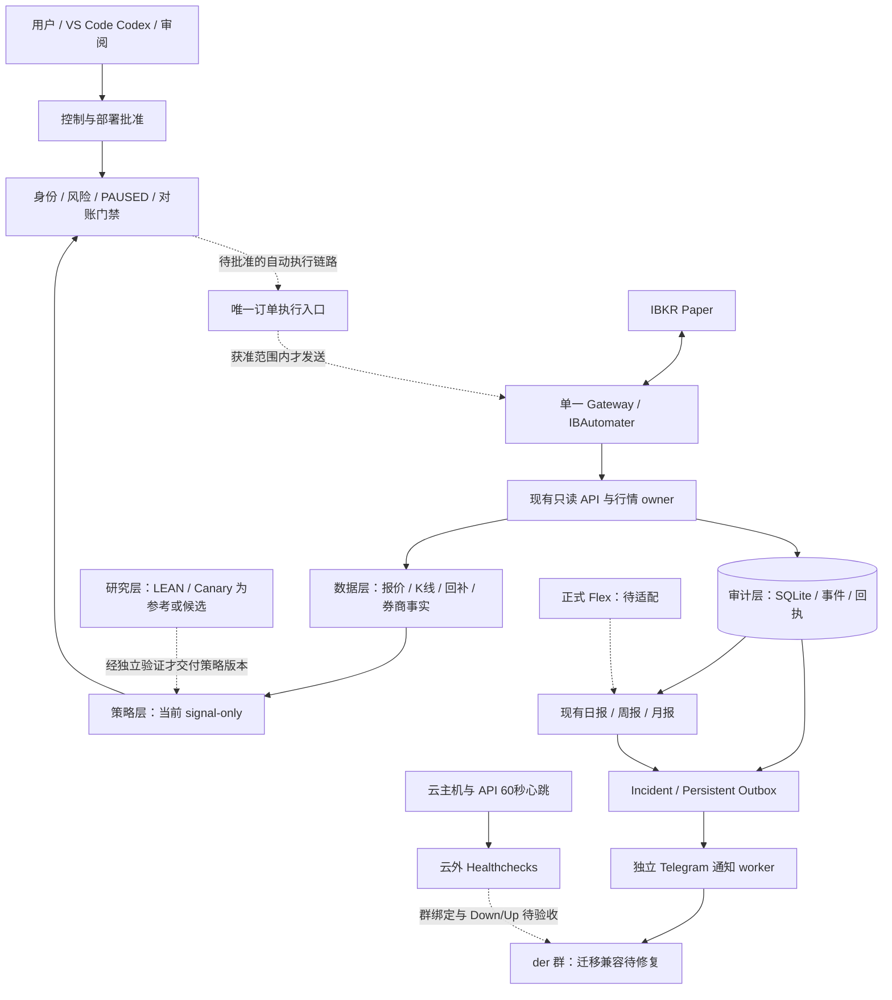

# 总体设计与实际交付状态（2026-11-06）

本文件把旧工程手册的六层业务架构与现有代码、云端部署和验收边界对齐。它是有日期的状态快照，不是运行批准；实时运行与门禁仍需按 PRODUCTION.md 重新只读核实。

## 当前总体结构

实线描述现有组件的数据关系，不表示每条链路当前健康；虚线明确标记待完成或需单独批准的路径。监控恢复不授予交易权限，回测不直接放行订单。

## 逐模块状态

“已有代码”“已部署”“真实验收”分别列出。存在类、脚本、测试或旧报告，不等于当前生产正在运行。

| 旧设计模块 | 代码与接线 | 部署 / 运行证据 | 验收与未完成 |
| --- | --- | --- | --- |
| 用户控制 / API / Dashboard | 有控制、API和Dashboard代码 | 旧本地入口与新云监测入口并存；VS Code扩展已安装 | 当前可见IDE是受限模式；统一操作台与现行入口整理未完成，不直接使用旧菜单恢复生产 |
| Runtime / Mode 9 | 有生命周期、循环、锁、资源管理 | 正式自动执行仍暂停；云端主要是只读采集、信号观察与通知 | 未完成持续全自动运行验收；不能据文件存在重新启动 |
| 数据层 | 账户、订单、成交回读；quotes/bars/history | 已部署到现有单owner；最新审计有连续K线与complete历史样本 | 报价、时段、完整性及持续恢复分别验证；过去无覆盖区间UNKNOWN |
| 研究层 | 候选材料、证据、LLM预审结构 | LEAN/Canary全引擎没有当前生产接线证明 | 未完成自动研究→候选→样本外验证的持续流水线 |
| 策略层 | 策略模块、目录、信号调度 | 云observer为MONITOR_ONLY、transmit=False | 不具备已批准的自主下单权限 |
| 风控层 | 身份、资金、行情、重复操作、对账、暂停等门禁 | 全局NOT_READY / SAFE_MONITOR_ONLY / PAUSED保留 | 权威状态、日历及策略风险等未完成自动放行验收 |
| 执行层 | 有订单、意图、操作身份及对账 | 有限Paper撤单/买入/平测试仓三笔已真实闭环 | scope已关闭且预算耗尽，不能复用；不等于持续自动交易 |
| 审计层 | SQLite、事件、原生ACK、运行历史 | 已使用；新增runtime_health与heartbeat_delivery已实际写入 | 历史覆盖不完整；观测跨度与实际停机时长分开 |
| 六层股票池 | 权威持久状态机与迁移记录已有 | Mode 9历史监测/state接线，另有七池报告 | 池成员资格不能授权订单；不声称当前云自动选股/交易流水线已运行 |
| AI自主复盘 | 手册、候选审核和证据/报表基础 | 没有持续定时AI复盘完整生产闭环证据 | 需独立输入快照、分析版本、引用、产物及审核机制；不能自动改风险/策略 |
| 报告与通知 | 定时报表、Incident、Outbox、Telegram | 应用Telegram曾有39条接受；云外心跳60秒 | der迁移ID/受众校验兼容与外部群绑定仍未验收；正式Flex财务尚缺 |

代码证据：[pool_state.py](../trading/pool_state.py)、[pool_manager.py](../trading/pool_manager.py)、[paper_strategy_observer.py](../trading/paper_strategy_observer.py)、[incident_telegram.py](../reporting/incident_telegram.py)、[report_schedule.py](../reporting/report_schedule.py)、[runtime_history.py](../reporting/runtime_history.py)。历史真实Paper范围见[验收记录](production-audit/PAPER_ACCEPTANCE_20261106.md)。

## 六层股票池：唯一权威术语

交易业务层“数据 / 研究 / 策略 / 风控 / 执行 / 审计”与股票池六层是两种分类，不混用。

当前执行相关状态以 trading/pool_state.py 的 LAYERS 为准：

1. `MASTER_UNIVERSE`
2. `ELIGIBLE_UNIVERSE`
3. `SCAN_POOL`
4. `WATCH_POOL`
5. `SIGNAL_EXECUTION_READY_POOL`
6. `PAPER_EXECUTION_POSITION_POOL`

旧图的 Master / Discovery / Watch / Monitor / Hot / Trade 保留为历史设计语言，**不与新状态逐项强行一一映射**。尤其旧Trade Pool既可能指候选资格，也可能被误解成已持仓；现在L5候选就绪与L6执行/持仓必须区分。

pool_manager.py 的七池是报告视图：security_master、discovery_universe、tradable_universe、stream_eligible_pool、monitor_pool、hot_pool、trade_pool。它们为report_only、execution_active=False，不能替代权威六层状态机。后续界面可以展示旧俗称，但必须同时显示canonical layer、来源、时间、迁移原因和独立执行许可。

## 通知与独立监控边界

- 正常心跳静默。平台最后成功心跳后的60秒周期+60秒宽限，是Down判定目标，不是手机120秒必达保证。
- 主机资源采样目前约5分钟，不能与60秒发送频率混为一谈；采样器自身停更还需完善。
- 应用通知与云外Healthchecks是两条独立路径。整机失联时外部通知不能依赖被监测云上的worker。
- der升级为supergroup、3成员；本轮审计发现应用仍配置旧群ID，并固定count==2。不能删除身份校验来“变绿”；需明确迁移和允许的owner/Bot身份。
- Healthchecks后台最后核验仍是私聊user None、0/2分配、Never；Bot入群及/start不等于完成群绑定和真实送达。
- 确认未发可有界重试；STARTED/UNKNOWN持久保留且不自动重放。现有未发重试耗尽后的恢复路径仍需完善；不能承诺所有网络超时无限补发且无重复。
- 日/周/月报既定09:00 Asia/Shanghai，重叠合并。不得把当前账户快照报告称作正式Flex财务报告。

## 下一阶段验收顺序

| 优先级 | 交付 | 完成标准 |
| --- | --- | --- |
| P0 | Telegram新群兼容、云外群目标 | 精确群迁移、owner/Bot白名单核对；独立测试范围内验证应用与云外Down/Up及回执；历史消息不重发 |
| P1 | 行情/日历/风险与记录可靠性 | 三流分别核验；UNKNOWN不补造；资源与采样停更可追溯；未知操作不重放 |
| P1 | 股票池到信号的统一投影 | 同一标的canonical层、报告视图、信号与风控拒绝原因可追溯；界面不以池名授予许可 |
| P2 | 研究和AI复盘 | 版本化只读输入、样本外/成本验证、引用和复盘产物；分析不自动改策略或风险 |
| P2 | 正式财务及可选指标面板 | Flex账户/期间/费用来源核对；再按资源基线选择Prometheus/Grafana |
| 单独批准 | 自动执行上线 | 有界范围、账户与暴露、行情/日历、对账、风控、唯一owner、未知结果恢复、停止与回滚逐项验收；不得重用已关闭Paper scope |

本次文档对齐不代替上述功能实现，也不移除现有安全门禁。操作约束以[PRODUCTION.md](../PRODUCTION.md)为准，上游登记见[REPOSITORIES.md](../REPOSITORIES.md)。
